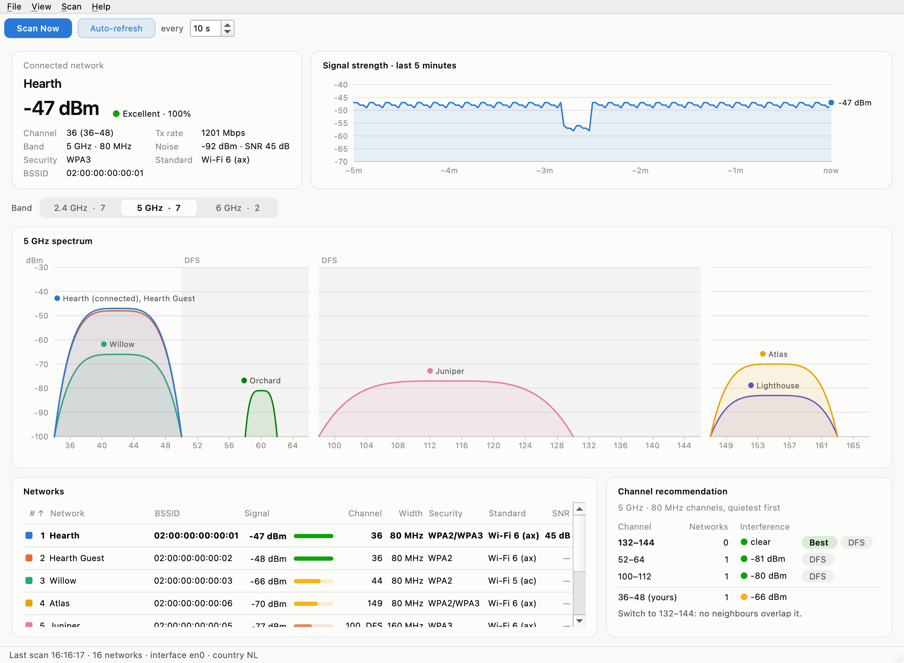

# wifianalyzer

A Wi-Fi analyzer desktop app for macOS, Windows and Linux. It shows:

- **Your connection**: signal, noise, SNR, channel block, transmit rate, Wi-Fi standard and a live signal history.
- **A spectrum chart per band**: each network is drawn as a curve over the frequencies it occupies, as high as its
  signal.
- **A network table**: signal, quality, channel (DFS marked), width, security, standard and SNR.
- **Channel recommendations**: candidate channels ranked by how much energy neighbouring networks put into them,
  compared with the channel you're on.

It runs entirely on your computer and doesn't connect to any service.

<picture>
  <source media="(prefers-color-scheme: dark)" srcset="docs/screenshot-dark.png">
  
</picture>

## Install

You need Python 3.11 or newer. Install it with [pipx](https://pipx.pypa.io):

```sh
pipx install git+https://github.com/nihatcanco/wifianalyzer
```

From a checkout of this repository, `pipx install .` works too, or `pip install .` in a virtual environment.

The app uses Qt (PySide6), which is installed along with it.

| | macOS 12+ | Windows 10 and 11 | Linux |
|---|---|---|---|
| Scans through | CoreWLAN | Native Wifi API | nl80211, the kernel's Wi-Fi interface |
| Network names | after you allow Location access | after you allow location access on Windows 11 | always |
| Noise and SNR | yes | not reported by Windows | for your channel, if the driver measures it |
| Fresh scans | always | always | with NetworkManager, iwd or root (see below) |

Any Linux driver from the last decade speaks nl80211. Virtual machines and WSL usually have no Wi-Fi interface to scan
with. On a Mac, newer Pythons need a newer macOS, because that's what Qt builds them for: macOS 12 runs up to Python
3.13, macOS 13 up to 3.14, and Python 3.15 needs macOS 14.

## Desktop app

```sh
wifianalyzer            # or: python -m wifianalyzer
wifianalyzer -i wlan1   # use a particular interface
```

Add `-v` to log what's happening to stderr. On Windows the command has no console to print to, so run
`python -m wifianalyzer -v` with the Python it's installed in to see the log.

- **Connection card and signal history**: your link's signal, quality, channel, rate, noise and the last five minutes
  of signal strength. Hover the history for exact readings.
- **Band picker** (Ctrl+1, 2, 3): chooses the band for everything below it.
- **Spectrum**: every network as a curve over the frequencies it occupies. DFS channels are shaded. Hover a curve for
  details; click it to select that network in the table, or click empty space to clear the selection.
- **Network table**: sortable by any column; selecting a row highlights its curve. Colors match the chart. Each
  network keeps its color while it stays in range, and your network is always blue. Networks beyond the eight
  available colors are gray.
- **Channel recommendation**: the quietest channels at your current width, compared with yours.
- **Scanning** runs in the background every 10 s by default (toolbar), or on demand with Ctrl+R or F5.
- **File › Save Scan** writes the scan and the recommendations for every band as JSON.

The window remembers its size, layout and scan interval. Light and dark mode follow the system. On a Mac, the shortcuts
use ⌘ instead of Ctrl.

## Permissions

Nearby Wi-Fi networks give away where a computer is, so macOS and Windows guard them as location data.

### macOS

Until the program has Location Services permission, CoreWLAN returns every network name and BSSID as empty. Everything
else still works: signal, channels, widths, security and the recommendations.

macOS only asks for that permission on behalf of an app whose `Info.plist` explains why it wants it. A plain `python`
process has none, so its requests are dropped without a prompt. That's also why turning on Terminal or VS Code in
Location Services doesn't help.

So wifianalyzer builds a small app bundle, **Wi-Fi Analyzer.app**, inside its Python environment. Its executable is a
launcher (`launcher.c`) that runs the environment's Python in its own process. To macOS, the program asking is then
Wi-Fi Analyzer.app. Building it needs Apple's command line tools (`xcode-select --install`), which Homebrew and pyenv
installs usually have already.

- **Allow Location Access** in the app builds the bundle, reopens the app from it and shows the prompt.
- Once the bundle exists, `wifianalyzer` switches into it on startup, so it sees network names after you've allowed
  access once.

The bundle is ad-hoc signed, and rebuilding it produces the same signature, so the permission survives rebuilds. If you
said no, turn on **Wi-Fi Analyzer** in **System Settings › Privacy & Security › Location Services**. The bundle goes
away with the environment: deleting the virtual environment, or `pipx uninstall wifianalyzer`, removes it.

### Windows

Since Windows 11 24H2, Windows only lists nearby networks to apps that may use your location. Without it, scans fail
and wifianalyzer says so. Turn on **Location services** and **Let desktop apps access your location** in
**Settings › Privacy & security › Location**; the app's **Open Settings** button takes you there. Windows 10 doesn't ask.

Interfaces go by the names Windows shows, such as `Wi-Fi`; `-i` also accepts the adapter's description or GUID.

### Linux

Any program may read scan results, so there's nothing to authorize. Starting a scan, though, needs the `CAP_NET_ADMIN`
capability. Without it, wifianalyzer asks NetworkManager (`nmcli`) or iwd (`iwctl`) to scan, as their own desktop
tools do. If neither is running, it shows the networks from the system's latest scan, which these services repeat on
their own every few minutes. Running as root also works, but isn't needed on a typical desktop.

## Runs locally

wifianalyzer doesn't connect to any service, and doesn't make the system do it either. `tests/test_offline.py` checks
this two ways. It reads the code, and fails if a module imports networking code, opens anything but a netlink socket,
contains an internet address, can open a web link or asks macOS for a position. Then it runs the app through a scan,
every band and Save Scan, and fails on any attempt to open a network socket, look up a name or open a web page.

- **No links**: nothing in the app opens a web page. There's no About Qt dialog either, because it links to qt.io.
- **Saved scans** list the networks around you, which shows where they were taken. Save Scan suggests your home
  folder rather than Documents or Desktop, which iCloud and OneDrive often sync.

- **macOS**: scan results come from CoreWLAN. Building the app bundle uses only local tools: clang, `codesign` with an
  ad-hoc signature and no timestamp server, and `open`. wifianalyzer asks for Location permission but never asks macOS
  where you are, because working out a position can make macOS query Apple's Wi-Fi positioning service.
- **Windows**: scan results come from `wlanapi.dll`, and interface names from `iphlpapi.dll`. The location setting
  only decides whether Windows hands over the scan; wifianalyzer never asks Windows for a position.
- **Linux**: scan results come from the kernel over a netlink socket, which never leaves the computer. Asking for a
  scan may run `nmcli` or `iwctl`.

Scanning does make your Wi-Fi radio send the usual probe requests that every device uses to discover networks.

## How channels are scored

For each candidate channel, wifianalyzer adds up the signal of every neighbouring network that overlaps it. A network
that only partly overlaps counts in proportion to the part of its width that falls inside the channel. The total is
shown in dBm: lower is quieter. Ties go to the channel with fewer networks, then to non-DFS channels. DFS channels must
give way to radar.

- **2.4 GHz** is evaluated at 20 MHz across 1, 6 and 11, the only channels that don't overlap each other.
- **5 and 6 GHz** are evaluated at your current width, or 80 MHz if you're not connected on that band, using the
  standard channel-bonding blocks.

Your own network isn't counted as interference: the access point you're connected to, networks with the same name, and
other names broadcast by the same radio (same channel, width and standard, within 3 dB). That last rule is a heuristic:
it can't tell your guest network from a neighbour with an identical setup and signal level.

## Limitations

- Scans only list the primary channel of a 40 MHz network on 2.4 GHz. The chart assumes the second channel is above the
  primary on channels 1–7 and below it on 8–13.
- 80+80 MHz networks are drawn and scored as their primary 80 MHz.
- macOS reports per-network noise for only a few networks, Linux only for your own channel and Windows not at all, so
  SNR is often blank in the table.
- Scanning briefly takes the radio off your channel. Keep scan intervals at a few seconds or more.

## Contributing

See [CONTRIBUTING.md](CONTRIBUTING.md) for the development setup, the tests and how the code is organized. Changes are
listed in [CHANGELOG.md](CHANGELOG.md).

## License

[MIT](LICENSE)
